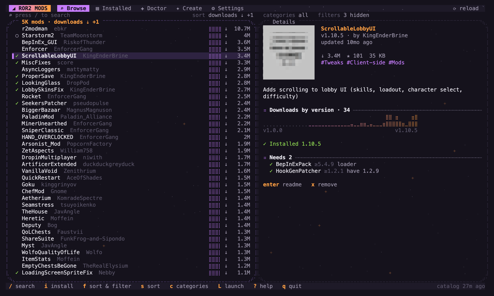
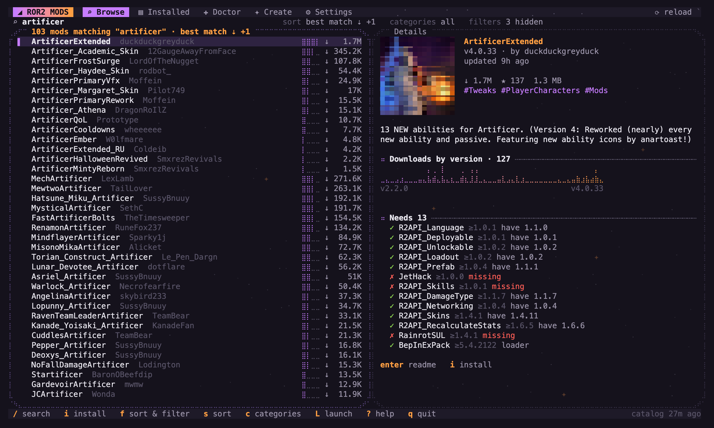
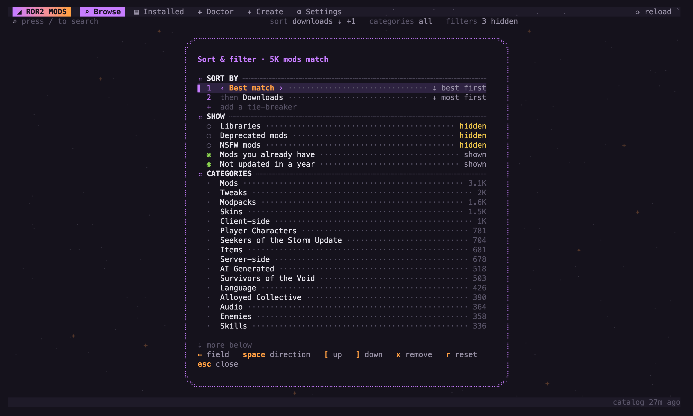
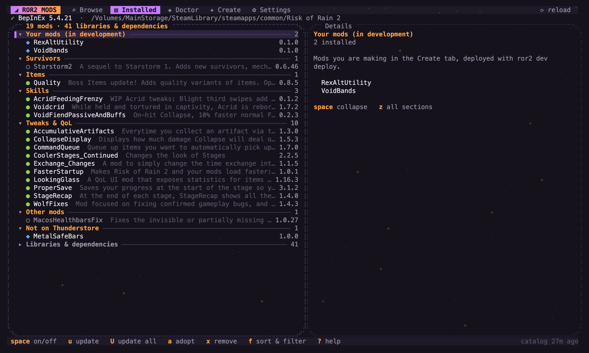
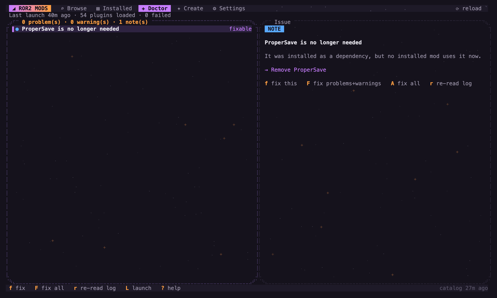
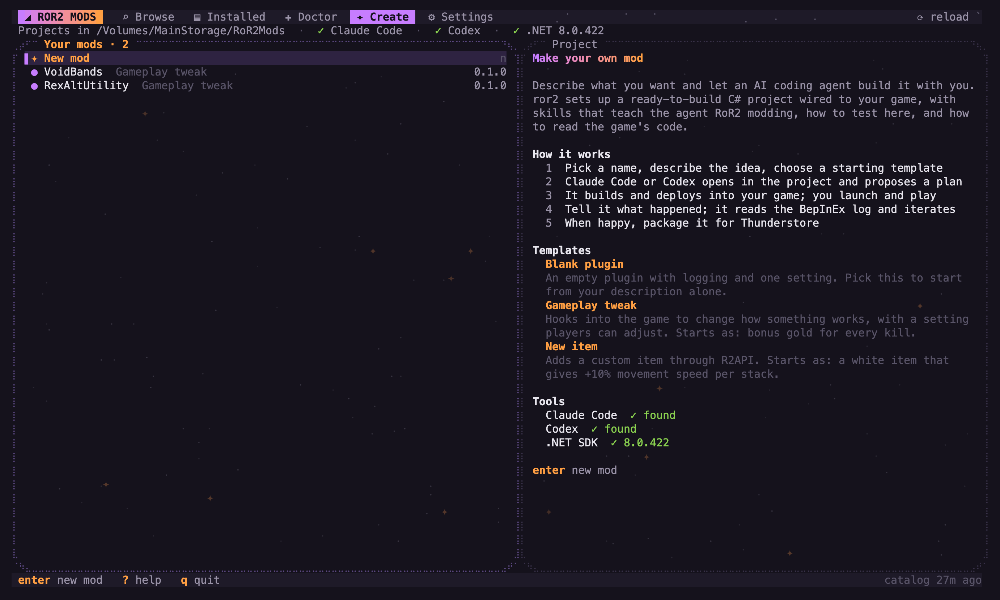
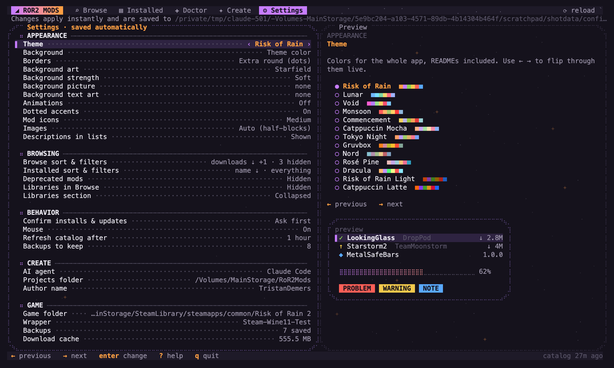

# RoR2 Mac Mod Manager

A terminal mod manager for **Risk of Rain 2 on macOS**. It installs and updates
[Thunderstore](https://thunderstore.io/c/riskofrain2/) mods, fixes missing dependencies,
launches the modded game, and helps you make your own mods with Claude Code or Codex.
No r2modman needed.

> [!IMPORTANT]
> **This is for Mac only.** Risk of Rain 2 has no Mac version, so on a Mac it runs
> through a [Sikarugir](https://github.com/Sikarugir-App/Sikarugir) Wine wrapper, and r2modman
> doesn't work there. This tool is built around that setup: it finds the game inside
> Sikarugir wrappers, launches it through the wrapper's Windows Steam, and uses macOS
> features (APFS backups, the macOS file picker, `~/Library` folders).
> **On Windows or Linux, use [r2modman](https://thunderstore.io/package/ebkr/r2modman/)
> instead**: it works there, and this tool won't.
>
> Tested on Apple Silicon (M-series) Macs. Intel Macs may work if you build with
> `GOARCH=amd64`, but that hasn't been tried.



## What you need

- A Mac running a recent macOS (built and tested on Apple Silicon)
- Risk of Rain 2 installed through Windows Steam inside a **Sikarugir** wrapper
- [Go](https://go.dev/dl/) 1.24 or newer to build it (`brew install go`)
- A terminal with full color. [Ghostty](https://ghostty.org) or kitty also show real mod
  icons; other terminals draw them with colored blocks.
- Optional, for making mods: the .NET SDK (`brew install --cask dotnet-sdk`) and
  [Claude Code](https://claude.com/claude-code) or Codex

## Install

```sh
git clone https://github.com/tdemers218/ror2-mac-mod-manager.git
cd ror2-mac-mod-manager
make install          # builds and copies the app to ~/.local/bin/ror2
```

Make sure `~/.local/bin` is on your `PATH`, then run `ror2`. On first start it looks for
your Sikarugir wrapper and game; check what it found with `ror2 config`.

## Commands

```
ror2                 full-screen app (Browse / Installed / Doctor / Create / Settings)
ror2 search <words>  search Thunderstore
ror2 install <mod>   install with all dependencies
ror2 update          update every tracked mod
ror2 doctor --fix    fix missing or too-old dependencies and load errors
ror2 adopt           start tracking mods that were installed by hand
ror2 import <code>   install an r2modman profile (code or .r2z file)
ror2 pack load <name>  switch to a saved mod pack (Vanilla = no mods)
ror2 launch          start the game through Steam in the wrapper
ror2 dev             make your own mods with Claude Code or Codex
ror2 help            everything else
```

## Screenshots

| | |
|---|---|
|  |  |
| **Search** ranks by best match, with live results as you type. | **Sort & filter**: up to four sort levels, and show or hide any mix of things. |
|  |  |
| **Installed** groups your mods by category and tucks libraries away. | **Doctor** checks dependencies and the game's last log, and fixes what it can. |
|  |  |
| **Create** sets up a C# mod project and opens your AI coding agent in it. | **Settings**: 13 themes, borders, background art, animations and more. |

## The app

`ror2` opens a full-screen app with six tabs: **Browse**, **Installed**, **Doctor**,
**Packs**, **Create** and **Settings**. Mouse and keyboard both work (`?` lists keys).
Settings has 13 themes (five inspired by Risk of Rain 2), border styles (including
dotted and braille-dot frames), dotted accents, icon size, image mode, list options,
confirmations, catalog refresh and backups. Everything saves to the config file instantly.
**Background art** (Settings → Appearance) fills empty space with a starfield, rain,
dots, grid lines, waves, a big planet, your own picture (drawn as tinted braille dots or
soft blocks) or a text-art file; pick files with the macOS picker or
`ror2 config set backdrop-image|backdrop-text <file>`. **Animations** (off by default)
add a comet trail behind the cursor, row flashes, sliding tabs, CRT-style dialogs,
unscrambling names, typed-out messages, sparkle bursts after installs, glinting progress
bars, and a moving background. The **Extra round** border draws smooth dotted corners.
Press `` ` `` (or F5) to reload from disk; it restarts into a newer build if one was installed.

**Sort & filter** (`f` in Browse or Installed, `c` jumps to categories):
sort by up to four things in order (for example downloads, then last updated),
each in either direction, and show or hide any mix of things at once. Browse can hide
libraries, deprecated, NSFW, already-installed and year-old mods, and show only or hide
any set of categories. Installed can hide disabled, hand-installed or up-to-date mods,
hide or isolate whole sections, or switch to one flat list. `s` / `S` change the first
sort level and flip its direction without opening the panel; `r` in the panel resets.

## Mod packs (Packs tab / `ror2 pack`)

Save the mods that are on right now as a named pack, and load it later to get exactly
that setup back. Loading switches mods on and off to match (hand-installed and dev mods
too) and downloads any pack mod you removed since, at the saved version. A pack can also
keep a copy of every mod's settings, put back when it's loaded. A backup is taken first.

The built-in **Vanilla** pack plays the plain game: it turns the mod loader off without
moving any files, so loading another pack afterwards is instant. The top bar shows a
**VANILLA** badge while it's on. `ror2 pack save <name> [--configs]`, `ror2 pack load
<name>`, `ror2 pack rename` and `ror2 pack delete` do the same from the command line.

## Making mods (Create tab / `ror2 dev`)

- **New mod** asks for a name, author, what it should do, and a template
  (blank, gameplay tweak, new item). It creates a C# project in your projects folder
  that compiles against your installed game and BepInEx, installs any R2API pieces
  the template needs, sets up git, and builds it once.
- Each project contains instructions for AI coding agents: `CLAUDE.md` +
  `.claude/skills/` for Claude Code, `AGENTS.md` + `.agents/skills/` for Codex.
  The four skills cover the build/test loop, reading the game's real code
  (`ror2 dev decompile`), content recipes with R2API, and Thunderstore releases.
- **Open in Claude Code / Codex** hands the terminal to the agent inside the
  project; quitting the agent returns to ror2. A new project's agent starts with
  your description as its first message.
- **Build / Deploy / Package**: deploy copies the plugin into
  `BepInEx/plugins/dev-<Author>-<Name>/`; package makes a Thunderstore zip in `build/`.
- `ror2 dev log` shows the mod's lines and errors from the last launch;
  `ror2 dev types` / `decompile` read game code with ILSpy (installed into the
  cache the first time).

## Raycast

The `raycast/` folder has three script commands:

| Command | Does |
|---|---|
| RoR2 Mod Manager | opens ror2 in a new Ghostty window, optionally searching for mods |
| RoR2 Make a Mod | opens ror2 on the Create tab |
| Launch Risk of Rain 2 (modded) | starts the game, no window |

Add them once: Raycast Settings → Extensions → **+** → Add Script Directory →
choose this project's `raycast` folder.

## How it works

- **Finding the game:** looks through Sikarugir wrappers for Windows Steam and its
  library folders, and picks the most recently used wrapper that has the game.
  See `ror2 config`.
- **Installing:** zips from Thunderstore are unpacked r2modman-style into
  `BepInEx/plugins/<Owner-Name>/` (and `patchers/`, `config/`). Existing config
  files are never overwritten. What ror2 installed is recorded in
  `BepInEx/.ror2mm/state.json`.
- **Hand-installed mods** are matched to Thunderstore packages by folder/DLL name and by
  the versions in BepInEx's log and DLL file info. `adopt` replaces them with tracked
  copies. Mods that are not on Thunderstore are left alone.
- **Doctor** checks the loader files, every mod's declared dependencies (missing,
  too old, disabled), and `BepInEx/LogOutput.log` from the last launch for plugins
  that refused to load. It maps plugin IDs from the log back to packages.
- **Disabling** moves a mod's files to `BepInEx/.ror2mm/disabled/` so BepInEx skips it.
- **Backups:** before every change, BepInEx is copied to `BepInEx/.ror2mm/backups/`
  as APFS clones (nearly free on disk). `ror2 backups` and `ror2 restore <name>`.
- **Launching:** if Steam is running in the wrapper, it sends
  `steam.exe -applaunch 632360`; otherwise it opens the wrapper first and waits for Steam.

## Images

Mod icons and README screenshots are drawn in the terminal:

- **Ghostty / kitty:** real images (kitty graphics protocol).
- **Other truecolor terminals** (including Apple Terminal on macOS 26): colored
  half-block characters, which is lower resolution but recognizable.
- Badges and SVGs are skipped; GIFs show their first frame.

Override with `ROR2MM_IMAGES=kitty|blocks|off`. Images are cached in
`~/Library/Caches/ror2mm/images/`.

## Grouping

The Installed tab and `ror2 list` group mods by Thunderstore category
(Survivors, Items, Tweaks & QoL…). Anything tagged "Libraries", or only present
because another mod needs it, goes into a collapsed **Libraries & dependencies**
section, so the list shows what you actually play with.

## Files

| What | Where |
|---|---|
| Settings | `~/Library/Application Support/ror2mm/config.json` |
| Catalog and downloaded zips (safe to delete) | `~/Library/Caches/ror2mm/` |
| Install record, disabled mods, backups | `<game>/BepInEx/.ror2mm/` |

## Building

```
make install   # builds for Apple Silicon and copies to ~/.local/bin/ror2
make test
GOARCH=amd64 go build -o bin/ror2 ./cmd/ror2   # Intel Mac (untested)
```

`ROR2MM_GAME_DIR=/some/folder ror2 …` points a single run at another game folder
(handy for testing on a copy).

## License

[MIT](LICENSE)
